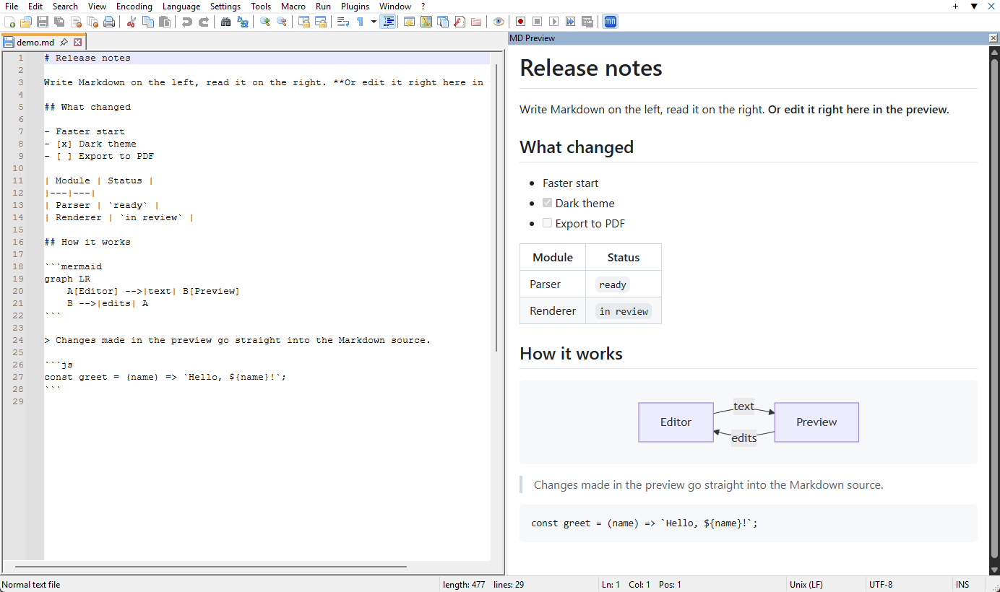

# MD Notepad

A Markdown preview panel for Notepad++. It shows the open document formatted, next to the editor, and works both
ways: type in the editor and the preview updates; type in the preview and the Markdown in the editor changes.



- GitHub-style look: headings, lists, task lists, tables, code blocks, quotes, links, images
- [Mermaid](https://github.com/mermaid-js/mermaid) diagrams (` ```mermaid ` code blocks)
- Light and dark theme; the preview scrolls along with the editor
- Export to PDF (A4)

## Install

**You don't need to install anything else on Windows. All you need is Notepad++** (64-bit or 32-bit).
No Node.js, Python or other programs: everything the plugin uses is already part of Windows 10 and 11.

Choose any of the four ways:

| | Way | Good for |
|---|---|---|
| 1 | [With Git](#1-with-git) | You already use Git and want easy updates |
| 2 | [Download and run the installer](#2-download-and-run-the-installer) | Most people |
| 3 | [Ask an AI assistant](#3-ask-an-ai-assistant) | You use an AI assistant that can run commands on your PC |
| 4 | [Plugins Admin in Notepad++](#4-plugins-admin-in-notepad) | Installing from inside Notepad++ |

After installing, start Notepad++ and click the **mn** button at the end of the toolbar.

### 1. With Git

```
git clone https://github.com/aideakit/mdnotepad.git
cd mdnotepad
.\install.cmd
```

`install.cmd` downloads the ready-made plugin from the latest release, checks its SHA-256 checksum and installs it.
To update later, run `git pull` and `.\install.cmd` again. To compile the plugin yourself instead, see
[Build from source](#build-from-source).

### 2. Download and run the installer

1. Download `MDNotepad-<version>.zip` from the [latest release](https://github.com/aideakit/mdnotepad/releases/latest).
   One archive serves both 64-bit and 32-bit Notepad++.
2. Unpack it anywhere.
3. Double-click **`install.cmd`**. If Windows asks whether to run the file, choose **Run**.

The installer finds Notepad++ by itself and asks you to close it if it is open. To update, do the same with the new
archive.

<details>
<summary>What the installer does, and installing by hand</summary>

It checks whether Notepad++ is 64-bit or 32-bit and that the WebView2 component of Windows is present, then copies
the plugin of the matching type to `<Notepad++>\plugins\mdnotepad`. If Notepad++ is under `Program Files`, Windows asks
for administrator rights.

- Several copies of Notepad++, or a portable one: `install.cmd -NppDir "D:\Tools\Notepad++"`
- By hand: close Notepad++, copy the `mdnotepad` folder from the archive into `<Notepad++>\plugins\`, then copy
  `bin\x64\mdnotepad.dll` (64-bit Notepad++) or `bin\x86\mdnotepad.dll` (32-bit) into `plugins\mdnotepad\`. You get
  `plugins\mdnotepad\mdnotepad.dll` and `plugins\mdnotepad\web\`. The 32-bit Notepad++ shows "32-bit" in **? > About**.
</details>

### 3. Ask an AI assistant

Tell an AI assistant that can run commands on your computer (Claude Code, Codex, Cursor and others):

> Install the MD Notepad plugin for Notepad++ from https://github.com/aideakit/mdnotepad

<details>
<summary>Instructions for AI assistants</summary>

Run this in PowerShell on the user's Windows computer. It downloads the latest release, verifies its SHA-256 checksum
and installs it without asking questions:

```powershell
& ([scriptblock]::Create((Invoke-RestMethod https://raw.githubusercontent.com/aideakit/mdnotepad/main/installer/get.ps1))) -Quiet
$LASTEXITCODE
```

| Result | Meaning | What to do |
|---|---|---|
| `0` | Installed | Tell the user to start Notepad++ and click the **mn** toolbar button |
| `2` | Notepad++ is running | Ask the user to save their files and close Notepad++, then run the command again. Do not close it yourself: unsaved work would be lost |
| `3` | Notepad++ not found, or several copies found | Add `-NppDir "<folder that contains notepad++.exe>"`; if several copies are listed, ask the user which one |
| `1` | Other error | Report the printed `ERROR:` message |

If the folder needs administrator rights, Windows shows a permission prompt that the user has to accept.
</details>

### 4. Plugins Admin in Notepad++

In Notepad++ open **Plugins > Plugins Admin...**, find **MD Notepad** on the **Available** tab, tick it and click
**Install**. Notepad++ restarts and the plugin is ready.

> The plugin appears in this list after it is accepted into the
> [official Notepad++ plugin list](https://github.com/notepad-plus-plus/nppPluginList). Until then, use one of the
> other three ways.

### Requirements and removal

- **Notepad++ 64-bit or 32-bit** (tested with 8.9.8). The ARM64 version is not supported.
- **Windows 10 or 11.** The preview uses Microsoft Edge WebView2, which is part of Windows 11 and up-to-date Windows 10.
  On a rare older system without it, the installer tells you and gives the
  [download link](https://developer.microsoft.com/microsoft-edge/webview2/).
- **Remove:** in Plugins Admin (**Installed** tab), or close Notepad++ and delete `<Notepad++>\plugins\mdnotepad`.

## Use

Open or close the preview with the **mn** toolbar button, **Ctrl+Alt+Shift+M**, or
**Plugins > MD Notepad > Show/hide preview panel**. The panel can be moved or undocked like any Notepad++ panel.

### Editing in the preview

Click in the preview and type: the text goes into the Markdown source at the matching place, as one undo step in
the editor, and the editor jumps to it.

| In the preview | What happens in the source |
|---|---|
| Typing, Delete, Backspace, Ctrl+Backspace | The same change to the text; `**bold**`, `` `code` `` and links keep their markup |
| Paste | Pasted as plain text |
| Enter | Splits the paragraph; in a list starts a new item; in an empty item ends the list |
| Enter at the end of a heading or paragraph | Shows an empty paragraph; it is written to the source once you type in it |
| Shift+Enter | Line break inside the paragraph |
| Backspace at the start of a paragraph or item | Joins it to the one before |
| Ctrl+B / Ctrl+I | Wraps the selection in `**` / `*` |
| Ctrl+Z / Ctrl+Y | Undo / redo in the document |
| Ctrl+S | Saves the document |
| Ctrl+click on a link | Opens it (a plain click places the cursor) |

Diagrams, images, raw HTML and table structure are changed in the editor; Backspace never deletes a diagram or a
horizontal rule that stands between two paragraphs.

### Menu: Plugins > MD Notepad

| Item | What it does |
|---|---|
| Show/hide preview panel | Opens or closes the panel; Notepad++ remembers it for the next start |
| Sync scroll | The preview follows the editor's scroll position |
| Dark theme | Dark preview |
| Edit in preview | Turns editing in the preview on or off (on by default); when off, a plain click opens links |
| Export PDF... | Saves the preview as an A4 PDF (always in the light theme) |

Settings are kept in `mdnotepad.ini` in the Notepad++ plugin settings folder (`%APPDATA%\Notepad++\plugins\config`,
or `plugins\Config` of a portable Notepad++).

## Good to know

- Images with a relative path (``) are loaded from the document's folder (local or mapped drives;
  not `\\server\share` paths). `#heading` links jump inside the preview; web and mail links open in your browser.
- The document should be UTF-8 or the system's ANSI code page; other encodings may show wrong characters.
- Scroll sync follows the position in the document proportionally, so it is close but not line-exact.
- Large documents are fine: after an edit only the changed blocks are redrawn (a keystroke in a 5,000-line document
  takes a few milliseconds).

## Build from source

This is only for developers; using the plugin does not need any of it. Needs Node.js and Visual Studio Build Tools
(C++ workload and a Windows SDK).

```
powershell -ExecutionPolicy Bypass -File build.ps1 -Install
```

It builds the plugin for 64-bit and 32-bit Notepad++. `-Install` also installs the result into Notepad++ (add
`-NppDir "<folder>"` for a specific copy). If the compiler is not found automatically, add
`-VcVars "<path>\vcvars64.bat"` (`vcvarsall.bat` must be in the same folder).

The first run installs the npm packages and downloads the `Microsoft.Web.WebView2` NuGet package (pinned version,
SHA-256 checked) into `third_party\`. The results go to `dist\`:

| File | Purpose |
|---|---|
| `mdnotepad\` | The plugin's shared files (`web\`, licenses) |
| `bin\x64\`, `bin\x86\` | `mdnotepad.dll` for 64-bit and 32-bit Notepad++ |
| `MDNotepad-<version>.zip` | For people: the plugin files, both DLLs and the installer |
| `mdnotepad-<version>-x64-plugins-admin.zip`, `...-x86-...` | For the Notepad++ plugin list (`mdnotepad.dll` at the root of the archive) |
| `SHA256SUMS.txt` | Checksums of the three archives |
| `pl.x64-entry.json`, `pl.x86-entry.json` | The ready entries for the Notepad++ plugin lists |

Publishing a new version is described in [docs/RELEASING.md](docs/RELEASING.md).

| Path | Contents |
|---|---|
| `src\plugin.cpp` | The plugin: panel, WebView2, scroll sync, PDF, writing preview edits into the editor |
| `src\npp_api.h` | The part of the Notepad++ plugin interface that is used |
| `web\` | The preview page (bundled with esbuild); `preview.js` also maps the shown text back to the Markdown source |
| `install.cmd` | Installs from a clone of the repository |
| `installer\` | `install.cmd` and `install.ps1` (go into the archive), `get.ps1` (downloads a release and installs it) |
| `tools\make_icon.py` | Draws the toolbar icon `resources\mdnotepad.ico` |

Set the environment variable `MDNOTEPAD_LOG=1` to write a debug log to `%TEMP%\mdnotepad.log`.

## License

[MIT](LICENSE). Third-party components: [THIRD-PARTY-NOTICES.md](THIRD-PARTY-NOTICES.md).
